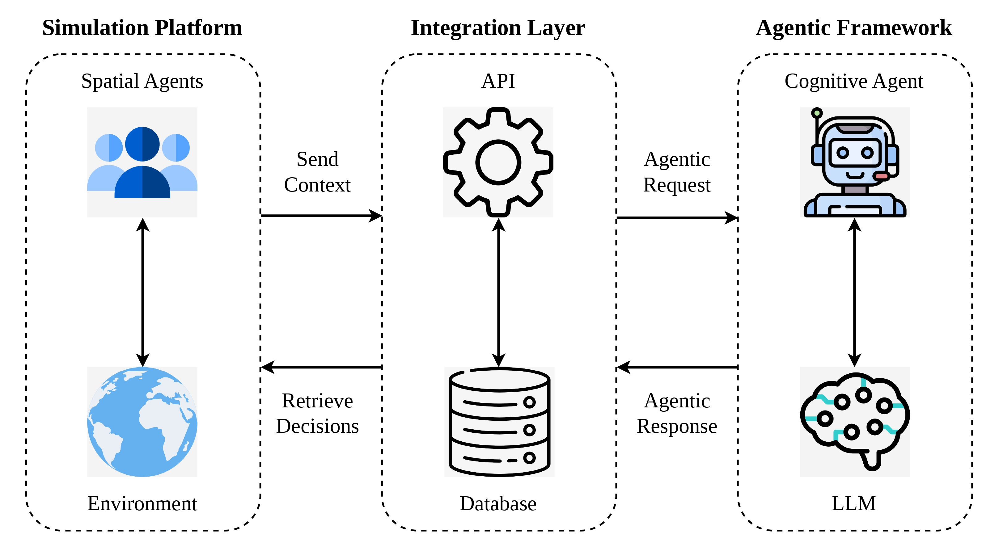

# Agentic MAS API

An API architecture for integrating LLM-based agentic systems with multi-agent simulations.

## Architecture

The architecture is composed of three main components:

1. **Simulation Platform** – Responsible for representing the environment and spatial agents.
2. **Integration Layer** – Responsible for communication, orchestration, and data persistence.
3. **Agentic Framework** – Responsible for contextual reasoning and LLM-based decision-making.



## Project Structure

```text
src/
├── agentic/      LLM-based agent implementations and integrations.
├── api/          FastAPI layer containing routes, schemas, and services.
├── config/       Application settings and global configurations.
├── db/           Database models, connections, and PostgreSQL persistence operations.
├── simulation/   Agent-based simulation models and execution logic.
└── main.py       FastAPI application entry point.
```

## Prerequisites

* Docker Compose
* Git
* PostgreSQL
* Python 3.14+

## Setup

### 1. Clone the repository

```bash
git clone <repository-url>
cd <repository-name>
```

### 2. Configure environment variables

Create a `.env` file in the project root and configure the required environment variables defined in `src/config/settings.py`.

### 3. Create a virtual environment

```bash
python3 -m venv .venv
source .venv/bin/activate
```

### 4. Install dependencies

```bash
pip install -r requirements.txt
```

### 5. Start the database infrastructure

```bash
docker compose up -d
```

### 6. Run the API

```bash
uvicorn src.main:app --reload --host 0.0.0.0 --port 8000
```

## API Documentation

After starting the application:

* Swagger UI: http://localhost:8000/docs
* ReDoc: http://localhost:8000/redoc

> Documentation is currently under development.